# Laporan Usability & Alur Penggunaan (Product Workflow & Usability Audit)
**Financial Tracker (Aplikasi Manajemen Keuangan Pribadi PWA)**  
**Auditor:** usability-expert  
**Status:** Draf Analisis Komprehensif  
**Target File:** `docs/0.draft/usability-analysis.md`  

---

## 1. Ringkasan Eksekutif & Metodologi Audit Usability

### 1.1 Latar Belakang & Tujuan
Financial Tracker dirancang sebagai aplikasi *personal ledger* modern (PWA mobile-first) untuk mencatat arus kas, mengawasi tagihan kartu kredit, melacak utang/piutang, serta memantau anggaran 50/30/20 dan kekayaan bersih (*net worth*).

Aplikasi keuangan harian memiliki karakteristik unik: **keberhasilan produk ditentukan oleh frekuensi retensi pencatatan tanpa friksi**. Pengguna membuka aplikasi saat sedang berdiri di kasir supermarket, setelah transfer lewat m-banking di sela jam kerja, atau saat mengecek slip gaji bulanan. Jika alur pencatatan membutuhkan terlalu banyak *cognitive load* (beban mental), klik/tap berlebih, atau konsep akuntansi yang membingungkan, pengguna akan berhenti mencatat dalam waktu 2–3 minggu (*tracking fatigue*).

Audit ini bertujuan untuk:
1. Mengevaluasi 5 user journey inti dari sudut pandang kemudahan penggunaan (*effortless logging*).
2. Membedah *mental model mismatch* antara cara pikir orang awam finansial di Indonesia dengan model akuntansi *double-entry/ledger* di balik layar.
3. Mengidentifikasi titik gesekan (*friction points*), langkah berbelit-belit, dan risiko salah input.
4. Memberikan rekomendasi perbaikan alur (*streamlined workflows*), panduan *onboarding* (first-run wizard), konfigurasi *default* yang masuk akal, serta *micro-copy* yang bersahabat.

---

### 1.2 Metodologi Evaluasi
Audit dilakukan menggunakan kombinasi metodologi evaluasi UX/Usability standar industri:
- **Heuristic Evaluation (10 Prinsip Nielsen Norman Group):** Terutama *Match between system and the real world*, *Error prevention*, *Recognition rather than recall*, dan *Flexibility and efficiency of use*.
- **Cognitive Walkthrough:** Menelusuri skenario nyata langkah demi langkah untuk menguji apakah pengguna awam dapat menebak aksi selanjutnya dengan benar dan memahami umpan balik sistem.
- **GOMS / KLM (Keystroke-Level Model):** Mengukur jumlah tap, pergantian fokus input, dan waktu yang dihabiskan untuk mencatat transaksi harian cepat (*Quick Add*).
- **Mental Model Alignment Check:** Memeriksa keselarasan terminologi aplikasi dengan kebiasaan finansial masyarakat Indonesia (misal: "gajian tanggal 25", "gesek CC bebas bunga", "talangan makan siang", "amplop kebutuhan").

---

### 1.3 Persona Pengguna Representatif

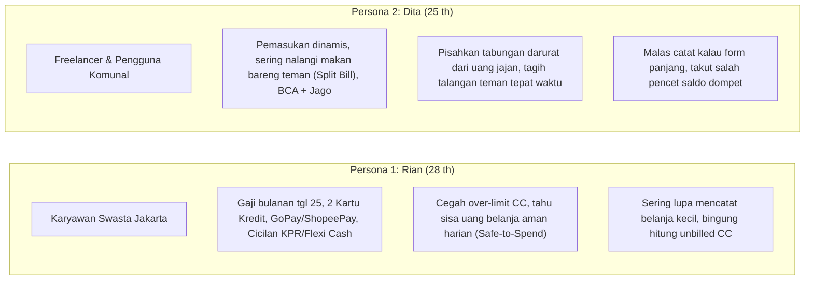

---

## 2. Evaluasi Mendalam User Journey Utama

### 2.1 User Journey 1: Pencatatan Transaksi Harian Cepat (Quick Add)
*Komponen Utama:* [`QuickAddSheet.tsx`](../../app/client/src/components/QuickAddSheet.tsx#L39-L1304)

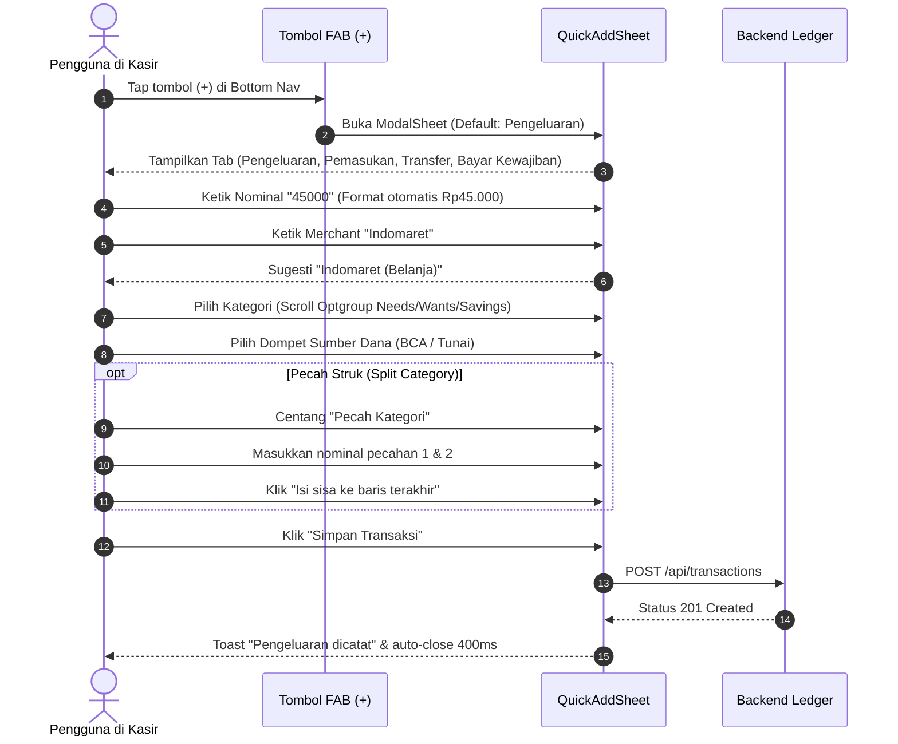

#### Temuan Usability & Gesekan Kognitif:
1. **Urutan Bidang Input (Field Ordering) Tidak Sejajar dengan Auto-Suggest:**
   - Di [`QuickAddSheet.tsx#L675-L950`](../../app/client/src/components/QuickAddSheet.tsx#L675-L950), urutan form adalah:
     1. Nominal (Rp)
     2. Tombol preset nominal (+10rb, +25rb, dll.)
     3. Merchant / Keterangan (dengan auto-suggestion)
     4. Sumber Dana (Dompet)
     5. Kategori
   - *Masalah:* Fitur *merchant auto-suggestion* [`handleMerchantChange`](../../app/client/src/components/QuickAddSheet.tsx#L461-L475) secara otomatis mengisi **Kategori** dan **Dompet** jika merchant dikenali. Namun karena letak Merchant di bawah Nominal dan sebelum Dompet, pengguna sering kali sudah terlanjur bingung memilih dompet/kategori manual sebelum sistem sempat melengkapi otomatis.
2. **Preset Nominal Akumulatif vs Pengganti Nilai (Replace vs Add):**
   - Tombol `+10rb`, `+25rb`, `+50rb`, `+100rb` di baris [`L710-L726`](../../app/client/src/components/QuickAddSheet.tsx#L710-L726) menambahkan nominal berjalan (`current + addVal`).
   - *Masalah Mental Model:* Pengguna awam yang baru membuka form dengan input `0` dan menekan `+50rb` memang mendapatkan `50.000`. Namun jika ingin mengubah dari 50.000 ke 100.000, menekan `+100rb` menjadikannya `150.000`. Pengguna harus menekan "Reset" lalu menekan ulang. Tidak ada preset nominal langsung (*direct set*).
3. **Dropdown Kategori Panjang pada Layar Ponsel:**
   - Kategori pengeluaran menggunakan elemen `<select>` native HTML dengan `<optgroup>` [`L958-L987`](../../app/client/src/components/QuickAddSheet.tsx#L958-L987).
   - Pada ponsel Android/iOS berlayar kecil (360–390px), membuka native select dengan 15–20 kategori memunculkan roda pemilih (*wheel picker*) atau dialog fullscreen yang lambat discroll. Tidak ada pencarian teks (*searchable dropdown*) atau chip kategori terpopuler (*top-used categories*).
4. **Alur Pecah Kategori (Split Struk) yang Memakan Ruang Layar:**
   - Fitur Split Struk [`L1000-L1165`](../../app/client/src/components/QuickAddSheet.tsx#L1000-L1165) sangat akurat secara akuntansi dengan indikator `splitDelta`.
   - *Masalah:* Saat pengguna menambah pecahan ke-3 atau ke-4, form melar ke bawah melewati batas *viewport* modal sheet. Tombol submit "Simpan Transaksi" di baris [`L1280-L1298`](../../app/client/src/components/QuickAddSheet.tsx#L1280-L1298) terdorong keluar layar, memaksa pengguna melakukan scroll berulang kali untuk memeriksa apakah total sudah pas sebelum bisa menekan tombol simpan.
5. **Mode "Bayar Kewajiban" Berada di Tab yang Sama dengan Pengeluaran Rutin:**
   - Tab header di [`QuickAddSheet.tsx#L25-L30`](../../app/client/src/components/QuickAddSheet.tsx#L25-L30) memuat 4 tab: `Pengeluaran`, `Pemasukan`, `Transfer`, `Bayar Kewajiban`.
   - Di layar mobile < 380px, membagi 4 tab membuat label teks terpotong atau sangat padat. Selain itu, aksi membayar cicilan utang/CC biasanya dipicu dari kartu tagihan di dashboard, bukan dari inisiatif membuka tombol `+` di jalan.

---

### 2.2 User Journey 2: Pengelolaan Siklus Gajian & Transisi ke Periode Baru
*Komponen Utama:* [`ReceiveSalaryModal.tsx`](../../app/client/src/components/ReceiveSalaryModal.tsx#L13-L228), [`OverviewPage.tsx`](../../app/client/src/pages/OverviewPage.tsx#L153-L170), [`SettingsPage.tsx`](../../app/client/src/pages/SettingsPage.tsx#L1637-L1680)

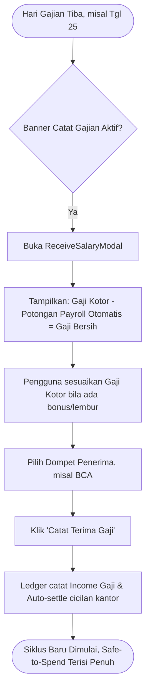

#### Temuan Usability & Gesekan Kognitif:
1. **Kebingungan Mental Model "Siklus Gajian" vs "Bulan Kalender":**
   - Aplikasi menggunakan model siklus gajian (misal tanggal 25 s.d. 24 bulan berikutnya).
   - Di [`OverviewPage.tsx#L120-L141`](../../app/client/src/pages/OverviewPage.tsx#L120-L141), pemilih periode menampilkan rentang teks, misalnya `25 Jan – 24 Feb 2026`.
   - *Friksi Pengguna:* Pengguna awam sering kebingungan saat membuka aplikasi pada tanggal 5 Februari dan melihat grafik/riwayat bertuliskan periode Januari-Februari. Mereka sering bertanya: *"Mengapa belanja saya tanggal 5 Februari digabung dengan pengeluaran tanggal 28 Januari?"*. Kurangnya teks penjelas seperti: **"Siklus Gaji Januari (Sisa 19 hari menuju gajian berikutnya)"** menimbulkan friksi mental bagi yang terbiasa dengan mutasi kalender m-banking.
2. **Ketiadaan Input Tanggal Penerimaan Gaji di Modal:**
   - Pada [`ReceiveSalaryModal.tsx`](../../app/client/src/components/ReceiveSalaryModal.tsx#L129-L163), hanya ada input `Gaji Kotor` dan `Dompet Penerima`.
   - *Skenario Nyata:* Tanggal 25 jatuh pada hari Minggu, sehingga kantor mentransfer gaji lebih cepat pada hari Jumat tanggal 23. Pengguna membuka aplikasi pada tanggal 23 untuk mencatat gaji, namun transaksi di backend menggunakan tanggal kalkulasi siklus atau hari ini tanpa opsi eksplisit bagi pengguna untuk menentukan kapan uang riil tersebut masuk ke rekening.
3. **Penguncian Satu Kali Catat per Periode (`alreadyReceived` Lock):**
   - Pada baris [`L122-L127`](../../app/client/src/components/ReceiveSalaryModal.tsx#L122-L127) dan [`L217`](../../app/client/src/components/ReceiveSalaryModal.tsx#L217), jika gaji siklus tersebut sudah pernah dicatat, tombol simpan dinonaktifkan sepenuhnya.
   - *Friksi:* Banyak pekerja menerima gaji pokok di tanggal 25, lalu menerima uang insentif/reimbursement/lembur di tanggal 28. Karena alur gaji terkunci, pengguna terpaksa beralih ke *Quick Add* untuk mencatat pemasukan kedua, yang tidak terintegrasi dengan perhitungan potongan cicilan kantor atau ringkasan gaji bersih.

---

### 2.3 User Journey 3: Manajemen Kartu Kredit (Billed vs Unbilled, Cut-off, Settlement, Split Pay)
*Komponen Utama:* [`DebtsPage.tsx`](../../app/client/src/pages/DebtsPage.tsx#L428-L666), [`SplitPayModal.tsx`](../../app/client/src/components/SplitPayModal.tsx#L21-L187), [`OverviewPage.tsx`](../../app/client/src/pages/OverviewPage.tsx#L468-L511)

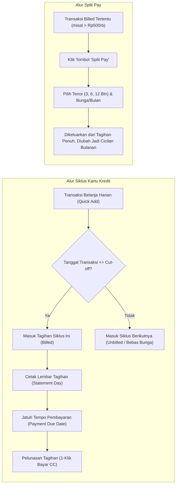

#### Temuan Usability & Gesekan Kognitif:
1. **Paradoks "Uang di Bank Masih Utuh, tapi Safe-to-Spend Berkurang" (Cashflow Protection Confusion):**
   - Sistem memiliki fitur proteksi arus kas brilian: setiap kali pengguna belanja memakai kartu kredit, sistem mencadangkan dana cair riil (`ccReservedCash`) dari saldo kas belanja agar pengguna tidak kaget saat jatuh tempo tagihan.
   - *Kebingungan Pengguna:* Pengguna awam sering kali mengeluh: *"Saya belanja pakai kartu kredit Jenius, kenapa uang jajan saya di aplikasi langsung berkurang? Kan belum bayar tagihannya!"*.
   - Kurangnya visualisasi grafis "Jembatan Likuiditas" (*Liquidity Bridge*) membuat pengguna mengira ada bug saldo ganda (*double deduction*).
2. **Ketiadaan Opsi Pembayaran Sebagian (Partial Settlement):**
   - Pada baris [`DebtsPage.tsx#L557-L571`](../../app/client/src/pages/DebtsPage.tsx#L557-L571), tombol aksi pembayaran tagihan CC adalah:
     `Bayar Tagihan (Rp X.XXX.XXX)`.
   - Tindakan ini memanggil alur pelunasan penuh tagihan siklus.
   - *Masalah Realistis:* Bagaimana jika saldo kas pengguna di dompet pelunas saat itu kurang dari total tagihan (misal tagihan 4,2 juta, saldo di bank hanya 3,5 juta)? Sistem saat ini memblokir pembayaran dengan peringatan merah: *"Saldo Dompet Tidak Mencukupi!"* [`QuickAddSheet.tsx#L660-L669`](../../app/client/src/components/QuickAddSheet.tsx#L660-L669). Pengguna tidak memiliki opsi untuk membayar sebagian (*partial payment*) secara resmi atau mencicil bayar 3 juta dulu, sehingga status tagihan tetap tertunggak.
3. **Visibilitas Fitur Split Pay (Discoverability Friction):**
   - Fitur *Split Pay* [`SplitPayModal.tsx`](../../app/client/src/components/SplitPayModal.tsx) sangat berguna untuk mengubah belanja besar (misal beli laptop atau servis mobil) menjadi cicilan bulanan.
   - *Masalah:* Tombol Split Pay hanya dapat diakses dengan membuka halaman `DebtsPage` -> scroll ke daftar transaksi CC siklus ini [`DebtsPage.tsx#L642-L659`](../../app/client/src/pages/DebtsPage.tsx#L642-L659). Saat pengguna baru saja mencatat transaksi 5 juta di Quick Add, tidak ada konfirmasi atau saran kontekstual: *"Transaksi kartu kredit Anda melebihi Rp1.000.000. Ingin ubah ke cicilan Split Pay sekarang?"*.

---

### 2.4 User Journey 4: Pencatatan Utang / Piutang (Peminjaman, Talangan Kasual, Pelunasan Bertahap, Early Payoff)
*Komponen Utama:* [`AddDebtModal.tsx`](../../app/client/src/components/AddDebtModal.tsx#L9-L443), [`DebtsPage.tsx`](../../app/client/src/pages/DebtsPage.tsx#L670-L1045)

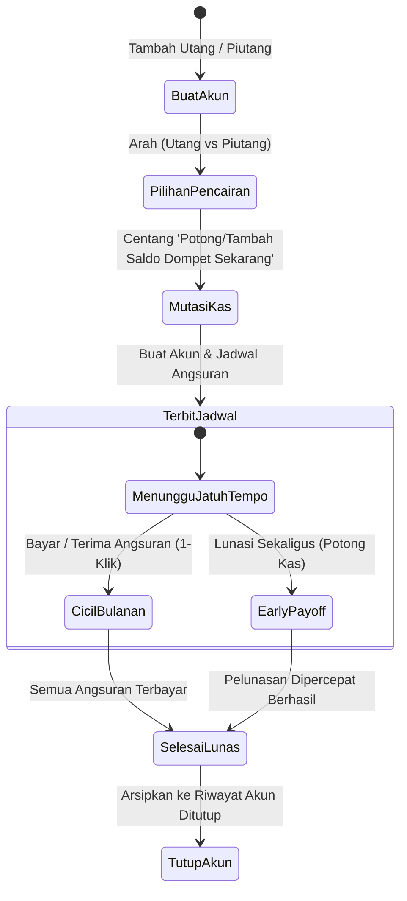

#### Temuan Usability & Gesekan Kognitif:
1. **Ketakutan Tertukar Antara "Utang Saya" vs "Piutang Teman":**
   - Dalam bahasa Indonesia percakapan sehari-hari, kata "utang" dan "piutang" sering tertukar. Orang sering mengatakan *"Gua ada utang sama si Budi"* (maksudnya Budi yang meminjam uang padanya).
   - Di [`AddDebtModal.tsx#L167-L190`](../../app/client/src/components/AddDebtModal.tsx#L167-L190), terdapat tab toggle `Hutang Saya (Saya Pinjam)` vs `Piutang (Saya Meminjamkan)`. Ini sudah baik, namun label formulir berikutnya:
     - `Keterangan Piutang / Talangan` vs `Peminjam / Pihak Berutang` [`L214-L225`](../../app/client/src/components/AddDebtModal.tsx#L214-L225).
     - Istilah "Pihak Berutang" terasa kaku seperti bahasa hukum notaris. Istilah yang lebih alami adalah: *"Siapa yang meminjam uang Anda?"* atau *"Nama Teman yang Ditalangi"*.
2. **Kekakuan Skenario "Talangan Makan Siang Kasual" (Overkill Form):**
   - Kasus paling jamak di kalangan anak muda/karyawan adalah menalangi makan siang teman kantor (misal Rp45.000) yang akan ditransfer balik sore nanti atau besok via QRIS.
   - *Masalah:* Membuka modal `AddDebtModal` yang mewajibkan pengisian `Jumlah Cicilan (Bulan)`, `Jatuh Tempo Pertama`, `Metode Bayar`, dan opsi pencairan dana terasa sangat berat (*high friction*). Akibatnya, pengguna malas mencatat talangan kecil ini, dan akhirnya saldo dompet riil mereka selisih saat rekonsiliasi.
3. **Pelunasan Sebagian Piutang Teman:**
   - Misal teman berutang Rp500.000 dengan jadwal 1 bulan. Lalu teman tersebut baru mentransfer Rp200.000.
   - Di daftar angsuran [`DebtsPage.tsx#L900-L906`](../../app/client/src/pages/DebtsPage.tsx#L900-L906), tombol aksi hanya bertuliskan `Terima`. Jika ditekan, sistem langsung menandai lunas Rp500.000 penuh!
   - Untuk mencatat pelunasan sebagian (Rp200.000), pengguna harus mencari tombol kecil "Lunasi Sekaligus" di kartu akun [`L750`](../../app/client/src/pages/DebtsPage.tsx#L750), lalu mengubah angka di input pelunasan dipercepat. Penamaan tombol "Lunasi Sekaligus" sangat tidak intuitif untuk aksi "mencicil sebagian".

---

### 2.5 User Journey 5: Tracking Budget 50/30/20, Runway Dana Darurat, dan Net Worth
*Komponen Utama:* [`Budget503020Progress.tsx`](../../app/client/src/components/Budget503020Progress.tsx#L6-L150), [`BudgetPage.tsx`](../../app/client/src/pages/BudgetPage.tsx#L428-L555), [`GoalsPage.tsx`](../../app/client/src/pages/GoalsPage.tsx#L79-L150), [`NetWorthHeroCard.tsx`](../../app/client/src/components/NetWorthHeroCard.tsx#L6-L117)

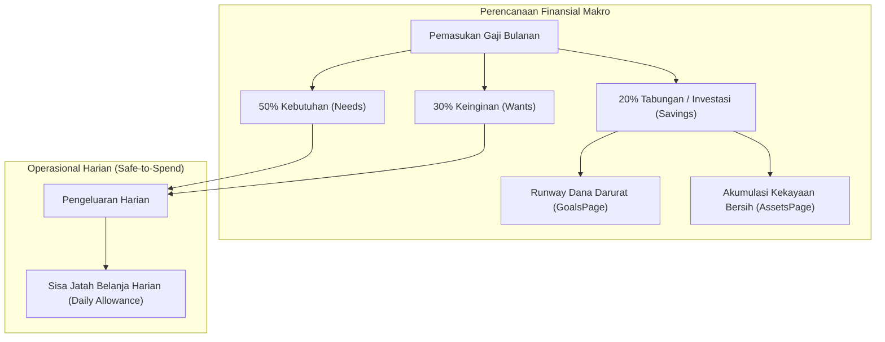

#### Temuan Usability & Gesekan Kognitif:
1. **Fokus Halaman Utama: Neraca Aset (Net Worth) vs Uang Belanja Harian (Safe-to-Spend):**
   - Saat ini, elemen paling atas di `OverviewPage` adalah [`NetWorthHeroCard`](../../app/client/src/components/NetWorthHeroCard.tsx#L25-L115) (Total Kekayaan Bersih = Aset - Liabilitas).
   - *Masalah Hirarki Usability:* Kekayaan bersih (*Net Worth*) adalah metrik evaluasi jangka panjang (biasanya ditinjau 1 bulan sekali). Ketika pengguna membuka aplikasi di minimarket atau restoran, pertanyaan utama di benak mereka adalah:
     *"Berapa sisa uang jajan saya hari ini / minggu ini tanpa mengganggu tabungan?"* (*Daily Allowance / Safe-to-Spend*).
   - Angka `Daily Allowance` dan `Safe-to-Spend` justru berada di baris bawah atau tersembunyi di sub-metrik, sementara angka puluhan/ratusan juta Net Worth mendominasi layar atas.
2. **First-Run Empty State pada Budget 50/30/20:**
   - Pengguna baru yang membuka `BudgetPage` [`BudgetPage.tsx#L284-L298`](../../app/client/src/pages/BudgetPage.tsx#L284-L298) disambut dengan kartu kosong bertuliskan *"Belum ada kategori kustom di kelompok..."*.
   - Tidak ada paket template instan (*One-click Preset*) standar Indonesia, misalnya:
     - Kebutuhan: Makanan Pokok, Listrik & Air, Transportasi/Bensin, Kontrakan/KPR, Pulsa/Internet.
     - Keinginan: Kopi & Nongkrong, Hiburan/Streaming, Belanja Fashion.
     - Tabungan: Tabungan Darurat, Reksadana/Saham.
   - Meminta pengguna baru mengetik dan mengelompokkan kategori satu per satu sebelum mulai memakai aplikasi menimbulkan *onboarding drop-off* yang tinggi.
3. **Kalkulasi Runway Dana Darurat yang Bergantung pada Data Historis:**
   - Di `GoalsPage` [`GoalsPage.tsx#L102-L117`](../../app/client/src/pages/GoalsPage.tsx#L102-L117), rumus ketahanan hidup (*runway months*) adalah `Total Dana Darurat / Rata-rata Kebutuhan Bulanan`.
   - *Masalah:* Jika pengguna baru memakai aplikasi selama 5 hari, pengeluaran kebutuhan bulanan belum memiliki riwayat yang stabil. Akibatnya angka runway bisa melonjak aneh (misal: "Runway 84 Bulan") atau bernilai nol jika belum ada transaksi berlabel "Kebutuhan", tanpa ada catatan penjelasan (*context hint*).

---

## 3. Matriks Friction Points & Masalah Mental Model

Berikut rekapitulasi titik friksi yang diidentifikasi di seluruh aplikasi:

| ID | Komponen & Lokasi File | Masalah Usability & Friction Point | Severity | Dampak Kognitif Pengguna |
| :--- | :--- | :--- | :--- | :--- |
| **F-01** | [`QuickAddSheet.tsx#L675-L950`](../../app/client/src/components/QuickAddSheet.tsx#L675-L950) | Merchant auto-suggest berada di bawah nominal & input kategori statis panjang. | **P1 (High)** | Pengguna membuang waktu memilih kategori manual padahal merchant bisa melengkapi otomatis. |
| **F-02** | [`QuickAddSheet.tsx#L708-L735`](../../app/client/src/components/QuickAddSheet.tsx#L708-L735) | Tombol preset nominal hanya bersifat aditif (+), tidak ada mode direct-set. | **P2 (Med)** | Salah input nominal karena akumulasi yang tidak disengaja. |
| **F-03** | [`QuickAddSheet.tsx#L1000-L1165`](../../app/client/src/components/QuickAddSheet.tsx#L1000-L1165) | Split struk mendorong tombol submit keluar dari layar (terlalu banyak scroll). | **P1 (High)** | Kesulitan verifikasi total pas pada layar ponsel pendek (< 667px). |
| **F-04** | [`ReceiveSalaryModal.tsx#L42-L145`](../../app/client/src/components/ReceiveSalaryModal.tsx#L42-L145) | Tidak ada pemilih tanggal penerimaan gaji (terkunci ke tanggal default sistem). | **P1 (High)** | Pengguna yang gajian maju di hari Jumat tidak bisa mencatat tanggal riil. |
| **F-05** | [`ReceiveSalaryModal.tsx#L122-L127`](../../app/client/src/components/ReceiveSalaryModal.tsx#L122-L127) | Penguncian total setelah 1x catat gaji (tidak mendukung bonus/THR/lembur terpisah). | **P1 (High)** | Kebingungan cara mencatat penghasilan kedua di bulan yang sama. |
| **F-06** | [`OverviewPage.tsx#L145-L171`](../../app/client/src/pages/OverviewPage.tsx#L145-L171) | Net Worth Hero Card mendominasi layar atas, menggeser Daily Allowance & Safe-to-Spend. | **P1 (High)** | Pengguna harian kehilangan fokus operasional "Berapa jatah belanja saya hari ini?". |
| **F-07** | [`DebtsPage.tsx#L557-L571`](../../app/client/src/pages/DebtsPage.tsx#L557-L571) | Pembayaran tagihan kartu kredit hanya bisa lunas 100%, memblokir saldo kurang. | **P0 (Critical)** | Pengguna tidak bisa mencatat pembayaran sebagian jika kas tidak cukup. |
| **F-08** | [`DebtsPage.tsx#L642-L659`](../../app/client/src/pages/DebtsPage.tsx#L642-L659) | Split Pay tersembunyi jauh di dalam tab kartu, tidak ada rekomendasi proaktif saat transaksi besar. | **P2 (Med)** | Fitur unggulan cicilan kartu kredit jarang ditemukan pengguna awam. |
| **F-09** | [`AddDebtModal.tsx#L9-L443`](../../app/client/src/components/AddDebtModal.tsx#L9-L443) | Alur pencatatan talangan kasual terlalu formal (harus isi tenor, metode, bunga). | **P1 (High)** | Malas mencatat pinjaman makan siang teman, memicu selisih saldo kas. |
| **F-10** | [`DebtsPage.tsx#L750-L755`](../../app/client/src/pages/DebtsPage.tsx#L750-L755) | Tombol "Lunasi Sekaligus" dipakai untuk mencatat pelunasan sebagian piutang. | **P2 (Med)** | Inkonsistensi istilah memicu keraguan apakah akun akan langsung tertutup. |
| **F-11** | [`BudgetPage.tsx#L284-L298`](../../app/client/src/pages/BudgetPage.tsx#L284-L298) | First-run empty state pada alokasi 50/30/20 kosong tanpa wizard template bawaan. | **P1 (High)** | Hambatan awal tinggi bagi pengguna awam yang belum paham budgeting. |
| **F-12** | [`ReconcileModal.tsx#L84-L135`](../../app/client/src/components/ReconcileModal.tsx#L84-L135) | Penyesuaian saldo langsung disimpan tanpa dialog konfirmasi nominal selisih besar. | **P2 (Med)** | Risiko salah ketik satu digit (misal kelebihan angka 0) merusak saldo dompet. |

---

## 4. Usulan Perbaikan Alur Pengguna (Streamlined Workflows)

### 4.1 Quick Add 2.0: Pencatatan Cepat Berbasis Prediktif & Ergonomis
Tujuan: Memangkas waktu pencatatan belanja harian dari **12–15 detik** menjadi **kurang dari 4 detik**.

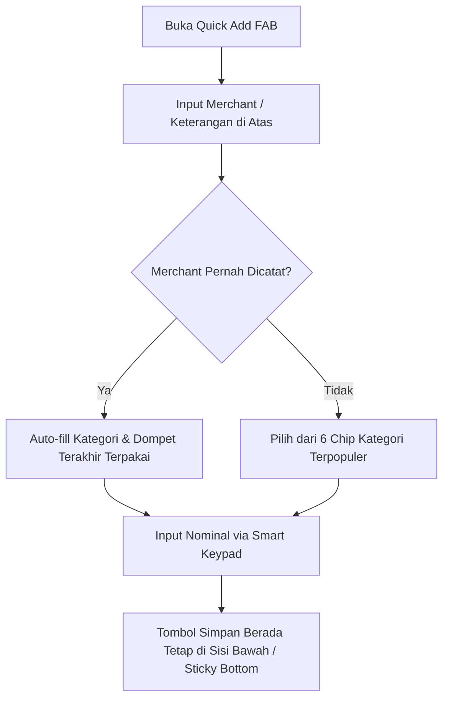

#### Spesifikasi Perbaikan:
1. **Pembalikan Urutan Input (Inverted Field Flow):**
   - Letakkan input **Merchant / Keterangan** di urutan teratas (atau berdampingan dengan Nominal).
   - Saat pengguna mengetik `"Kopi"`, sistem langsung menampilkan chip prediktif:
     `[ Kopi Kenangan · Rp22.000 · Makanan & Minuman · GoPay ]`.
   - Mengklik chip tersebut langsung melengkapi seluruh isian form dalam **1 tap**.
2. **Kategori Cepat (Top 6 Quick Chips) Menggantikan Native Select Panjang:**
   - Di bawah input kategori, sediakan 6 pill kategori paling sering dipakai (misal: *Makan & Minum, Bensin/Transport, Belanja Harian, Tagihan, Hiburan, Kebutuhan Rumah*).
   - Sediakan tombol `+ Lainnya` untuk membuka modal pencarian kategori lengkap.
3. **Pemberian Pilihan Mode Preset Nominal (Direct vs Add):**
   - Baris preset nominal menyediakan tombol nilai langsung: `[10rb] [20rb] [50rb] [100rb]` yang mengganti nilai seketika (*direct replace*), serta tombol kecil `[+10rb]` untuk penambahan.
4. **Checkbox Cepat "Ini Talangan Teman" Langsung di Quick Add:**
   - Pada form pengeluaran biasa, tambahkan toggle sederhana:
     `[x] Ditalangi teman? (Catat sebagai Piutang)`
   - Jika dicentang, sistem hanya meminta nama teman (misal: "Budi") dan dompet asal dana. Saldo dompet berkurang, namun pengeluaran tidak memotong budget belanja bulanan. Ini menyelesaikan friksi **F-09** secara tuntas!

---

### 4.2 Alur Transisi Periode Gajian & Penerimaan Gaji 2.0
Tujuan: Menghilangkan kebingungan kalender dan memberikan fleksibilitas penerimaan penghasilan ganda/bonus.

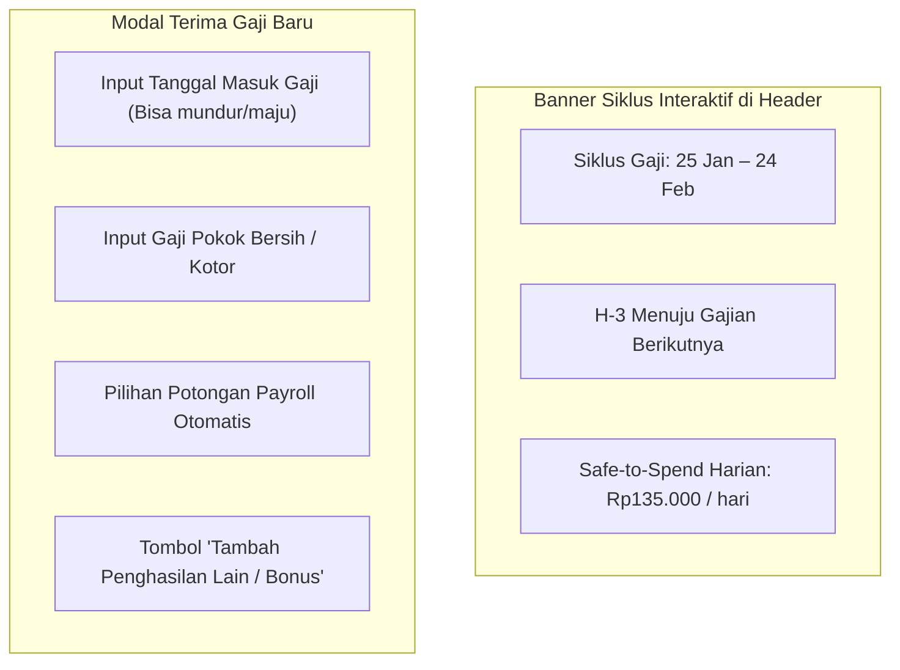

#### Spesifikasi Perbaikan:
1. **Tambahkan Input Tanggal Masuk Gaji di [`ReceiveSalaryModal.tsx`](../../app/client/src/components/ReceiveSalaryModal.tsx):**
   - Tambahkan input `<input type="date">` dengan *default* hari ini dan shortcut "Hari Ini / Tanggal Siklus".
2. **Dukungan Pemasukan Sekunder / Bonus (Multi-Payday per Cycle):**
   - Jika gaji siklus sudah tercatat, tombol tidak dimatikan, melainkan berubah menjadi:
     `+ Catat Bonus / Tunjangan Tambahan`.
   - Ini memungkinkan pencatatan THR, lemburan, atau bonus tahunan tanpa merusak data gaji pokok.
3. **Penyampaian Informasi Siklus yang Ramah Pengguna:**
   - Ubah label teknis *"Siklus Gajian (Tgl 25)"* menjadi:
     `Siklus Gajian Februari · Sisa 12 hari lagi (Gajian berikutnya: 25 Feb)`.

---

### 4.3 Alur Kartu Kredit & Proteksi Kas (Liquidity Bridge 2.0)
Tujuan: Mengedukasi pengguna tentang fasilitas bebas bunga tanpa menimbulkan kepanikan saldo semu.

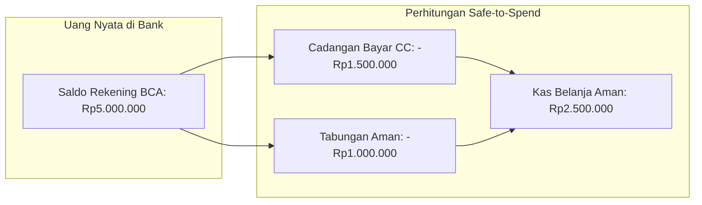

#### Spesifikasi Perbaikan:
1. **Kartu Jembatan Likuiditas (*Liquidity Bridge Card*):**
   - Tampilkan kartu mini transparan di halaman Kartu & Utang atau Ringkasan:
     > *"Saldo bank Anda Rp5.000.000. Aplikasi mencadangkan Rp1.500.000 untuk melunasi tagihan Kartu Kredit Jenius sebelum 10 Feb agar 100% Bebas Bunga. Sisa uang belanja bebas Anda adalah Rp3.500.000."*
2. **Dukungan Pembayaran Parsial Tagihan CC (*Partial / Custom Amount Payment*):**
   - Di modal pelunasan CC, sediakan radio button:
     - `(o) Bayar Lunas Penuh (Bebas Bunga): Rp4.200.000`
     - `( ) Bayar Nominal Lain (Sebagian): [ Rp 3.000.000 ]`
   - Berikan peringatan edukatif ramah jika bayar sebagian: *"Sisa tagihan Rp1.200.000 akan dikenakan bunga reguler oleh bank pada cetak tagihan berikutnya."*
3. **Nudge Konversi Split Pay Otomatis:**
   - Setelah mencatat transaksi kartu kredit dengan nominal di atas ambang batas (misal >= Rp500.000), munculkan toast interaktif:
     `[ Transaksi CC Rp2.400.000 tersimpan. Ubah ke Split Pay? ] -> [ Ya, Cicil ]`.

---

### 4.4 Hierarki Dashboard Operasional Adaptif
Tujuan: Menyesuaikan tampilan halaman muka (*OverviewPage*) dengan kebutuhan harian pengguna.

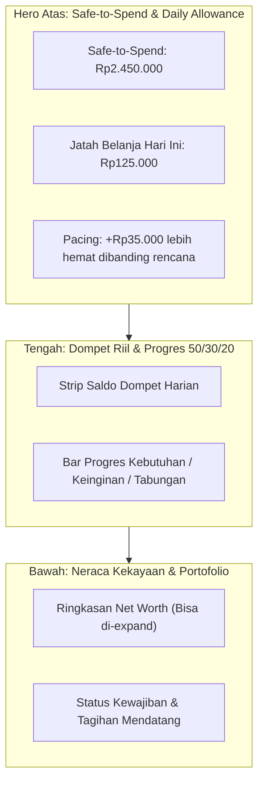

#### Spesifikasi Perbaikan:
1. **Kembalikan *Daily Allowance* & *Safe-to-Spend* ke Hero Utama:**
   - Pengguna membuka aplikasi berkali-kali sehari untuk melihat apakah mereka masih boleh jajan atau harus berhemat. Letakkan kartu *Safe-to-Spend* dengan jatah harian (*Daily Allowance*) di posisi pertama.
2. **Posisikan *Net Worth Hero Card* sebagai Kartu Portofolio Sekunder:**
   - Pindahkan kartu Total Kekayaan Bersih (*Net Worth*) ke bagian bawah atau sediakan toggle di Pengaturan:
     `Fokus Tampilan Utama: [ Jatah Harian (Operasional) | Kekayaan Bersih (Portofolio) ]`.

---

## 5. Panduan Onboarding & Konfigurasi Default Masuk Akal

### 5.1 Wizard Onboarding 3-Langkah (First-Run Experience)
Ketika pengguna pertama kali menggunakan aplikasi (data transaksi masih kosong), tampilkan layar pemandu interaktif (*First-Run Stepper*):

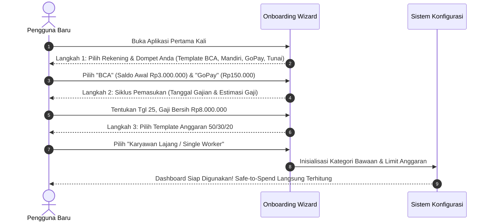

### 5.2 Template Paket Anggaran 50/30/20 Bawaan Indonesia

| Paket Template | Pos Kebutuhan (50%) | Pos Keinginan (30%) | Pos Tabungan (20%) |
| :--- | :--- | :--- | :--- |
| **Karyawan Lajang (Single)** | Makanan Pokok, Kost/Sewa, Bensin/Transport, Pulsa & Internet, Laundry. | Kopi & Nongkrong, Langganan Streaming, Belanja Online/Hobi, Hiburan Bioskop. | Dana Darurat (Bank Tabungan), Reksadana Pasar Uang / Saham. |
| **Keluarga Muda (Family)** | Belanja Dapur, Listrik/Air/IPL, Cicilan Rumah/KPR, Sekolah Anak, Asuransi Kesehatan. | Makan di Luar Weekend, Liburan Keluarga, Mainan Anak, Gadget/Fashion. | Tabungan Pendidikan Anak, Dana Darurat Keluarga, Emas Batangan. |
| **Freelancer / Gig Worker** | Makan Harian, Sewa Kamar/Coworking, Paket Data Cepat, Operasional Kerja. | Kafe & Working Space, Self-Reward, Beli Buku/Course. | Dana Cadangan Masa Sepi Project (*Buffer Fund*), Tabungan Hari Tua. |

---

### 5.3 Context-Aware Hints & Empty States Informatif
Daripada menampilkan teks kosong monoton seperti *"Belum ada data"*, terapkan prinsip *anti-slop action-oriented empty states*:

1. **Empty State pada Daftar Transaksi:**
   - *Teks:* *"Belum ada transaksi di siklus ini. Catat kopi pagi Anda atau pengeluaran pertama hari ini."*
   - *Aksi CTA:* Tombol `+ Catat Pengeluaran Pertama`.
2. **Empty State pada Daftar Kartu Kredit:**
   - *Teks:* *"Gunakan kartu kredit dengan bijak. Tambahkan kartu kredit Anda untuk melacak periode bebas bunga hingga 45 hari dan cegah denda keterlambatan."*
   - *Aksi CTA:* Tombol `+ Tambah Kartu Kredit`.
3. **Empty State pada Runway Dana Darurat:**
   - *Teks:* *"Ketahanan dana darurat akan dihitung otomatis setelah Anda memiliki minimal 3 transaksi kategori Kebutuhan atau saldo di dompet tabungan."*
   - *Aksi CTA:* Tombol `Setel Saldo Awal Tabungan`.

---

### 5.4 Penyesuaian Terminologi Keuangan dalam Bahasa Indonesia Sehari-hari

| Istilah Saat Ini | Usulan Terminologi Baru | Alasan UX & Keselarasan Mental Model |
| :--- | :--- | :--- |
| **Safe-to-Spend** | **Uang Belanja Bebas** / **Sisa Kas Aman** | Istilah bahasa Inggris membingungkan pengguna non-finansial; "Uang Belanja Bebas" menegaskan bahwa uang ini boleh dihabiskan tanpa mengganggu pos lain. |
| **Daily Allowance** | **Jatah Jajan Hari Ini** / **Batas Harian** | Sangat membumi dan langsung dipahami sebagai batasan pengeluaran harian. |
| **Disbursement** | **Pencairan / Transfer Dana** | Kata "Disbursement" terdengar seperti istilah teknis perbankan/akuntansi perusahaan. |
| **Pihak Berutang (Lender)** | **Nama Teman / Peminjam** | Lebih ramah untuk konteks sosial pinjam-meminjam antar teman atau keluarga. |
| **Early Payoff** | **Lunasi Sisa Sekaligus** | Menghilangkan kerancuan bahwa pelunasan sebagian bukan berarti akun langsung hangus. |
| **Cut-off Day** | **Tutup Buku Siklus** | Menggambarkan batas akhir pencatatan transaksi yang masuk lembar tagihan. |
| **Unbilled** | **Belanja Baru (Masuk Tagihan Depan)** | Pengguna langsung paham bahwa belanja tersebut belum perlu dibayar pada jatuh tempo terdekat. |

---

## 6. Rencana Implementasi & Roadmap Usability

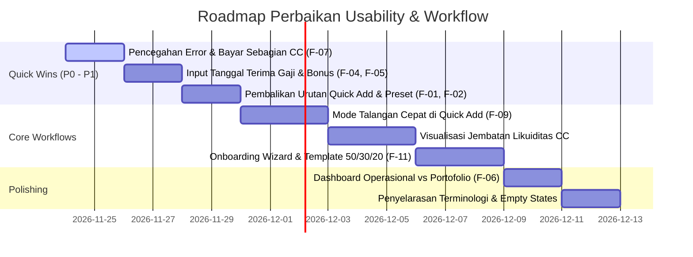

### Tahap 1: Quick Wins (Prioritas P0 & P1 - 1 Minggu)
- [ ] Buka opsi input nominal kustom pada pembayaran tagihan kartu kredit di [`DebtsPage.tsx`](../../app/client/src/pages/DebtsPage.tsx) agar pengguna dengan kas terbatas tetap bisa melunasi sebagian tagihan.
- [ ] Tambahkan pemilih tanggal penerimaan gaji di [`ReceiveSalaryModal.tsx`](../../app/client/src/components/ReceiveSalaryModal.tsx).
- [ ] Perbaiki alur form di [`QuickAddSheet.tsx`](../../app/client/src/components/QuickAddSheet.tsx) dengan mengutamakan pencocokan merchant dan menyediakan tombol preset nominal langsung.

### Tahap 2: Core Workflows & Integrasi Talangan (2 Minggu)
- [ ] Tambahkan fitur "Talangan Teman" langsung di Quick Add tanpa harus membuat akun utang formal.
- [ ] Sediakan modal onboarding wizard untuk pengguna baru yang menyajikan 3 template anggaran 50/30/20 khas Indonesia.
- [ ] Rancang kartu "Jembatan Likuiditas" di overview agar pengguna mengerti hubungan antara saldo bank riil, cadangan kartu kredit, dan uang belanja aman.

### Tahap 3: Polishing & Personalisasi Dashboard (1 Minggu)
- [ ] Implementasikan preferensi tampilan dashboard (Mode Operasional Harian vs Mode Portofolio Net Worth).
- [ ] Perbarui seluruh micro-copy dan pesan empty state di aplikasi agar komunikatif, edukatif, dan ramah pengguna.

---

## 7. Kesimpulan
Financial Tracker telah memiliki fondasi mesin akuntansi (*ledger engine*) dan fitur proteksi arus kas yang sangat kokoh dan akurat. Namun, untuk menjadikannya produk harian yang dicintai pengguna (*delightful daily driver*), aplikasi memerlukan penyederhanaan pada lapisan interaksi:
1. Mengurangi friksi pencatatan belanja hingga di bawah 4 detik lewat prediksi cerdas.
2. Membuka fleksibilitas dunia nyata (gaji fleksibel, bayar CC sebagian, talangan kasual).
3. Mengembalikan fokus pandangan pertama pengguna pada metrik operasional harian (*Daily Allowance* dan *Safe-to-Spend*).

Dengan mengimplementasikan cetak biru usulan di atas, Financial Tracker akan bertransformasi dari sekadar alat pencatat transaksi menjadi asisten finansial pribadi yang menenangkan, intuitif, dan bebas beban kognitif.
