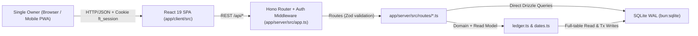

# Analisis Arsitektur Perangkat Lunak: Financial Tracker

**Sudut Pandang:** Software Architect  
**Objek Analisis:** `Financial-Tracker` (`docs/PRD.md`, `docs/DESIGN.md`, `docs/task-list/`, dan codebase aktual di `app/`)  
**Tujuan:** Mengevaluasi kesiapan arsitektur aktual terhadap spesifikasi, mengidentifikasi risiko integritas data keuangan, keamanan, dan skalabilitas, serta menyusun roadmap perbaikan berbasis trade-off dan ADR.

---

### Ringkasan Eksekutif (Poin Utama Temuan Arsitektur)
1. **Kondisi Saat Ini & Gap Spesifikasi:** Fondasi Modular/Monolith (`Bun + Hono + Drizzle/SQLite + React 19 + Tailwind v4`) sudah fungsional dan akurat pada metrik inti (`Safe-to-Spend`, CC billed/unbilled, Split Pay, migrasi legacy). Namun terdapat beberapa gap terhadap `PRD.md`/`DESIGN.md`/`task-list`: `vite-plugin-pwa` terpasang di `app/package.json` tetapi belum diaktifkan di `app/vite.config.ts`; `docs/task-list/task-phase-4.md` belum ada dan uji visual Chrome pada `task-phase-3.md` masih terbuka; edit dompet (`PATCH /api/wallets/:id`), budget override per periode (`YYYY-MM`), serta export CSV/JSON per periode belum diekspos di UI.
2. **Cacat Domain & Integritas Data Kritis:**
   - **Side-effect pada `GET` (pelanggaran CQS):** `computeLedgerSnapshot` di `app/server/src/lib/ledger.ts` dipanggil oleh seluruh endpoint `GET` (`/api/dashboard`, `/api/debts`, `/api/wallets`, `/api/budgets`, `/api/export`) sekaligus menjalankan mutasi `ensureMonthlyBankFees` dan `ensurePayrollAutoPaid`.
   - **God Module & Anemic Boundary:** `ledger.ts` (1.115 baris) mencampur kalkulasi snapshot full-table-scan ($O(N)$ per request) dengan command mutations, sementara route `transactions.ts` (`PATCH /:id` tidak memblokir `income` pada dompet `credit_card` maupun edit transaksi Split Pay yang sudah dikonversi).
   - **Edge Case Tanggal Siklus:** `periodBounds` di `app/server/src/lib/dates.ts` menggunakan `Math.max(1, gajianStartDay - 1)` dan `Math.max(1, cardCutoffDay - 1)`, sehingga jika user mengatur hari mulai/cutoff ke `1`, batas akhir periode bocor ke tanggal `01` bulan berikutnya.
   - **Referential Integrity:** `categories` terhubung via string nama (bukan `categoryId` FK), transfer + admin fee tidak punya link pasangan, pelunasan CC bergantung pada inferensi keberadaan transaksi `settlement` + hardcoded cutoff `"2026-10"`, dan `reconcileWalletBalance` melakukan read-then-insert di luar transaksi DB.
3. **Keamanan & Deployment VPS:** `getSessionSecret()` di `app/server/src/lib/auth.ts` memiliki fallback secret statis, `clientRateKey` memercayai `x-forwarded-for` secara langsung, `app/server/src/index.ts` menangkap path `/api/*` yang tidak dikenal ke `index.html` (200 OK), dan belum ada `PRAGMA busy_timeout`, graceful shutdown, maupun artifak deploy VPS.

---

## 1. Ringkasan Kondisi Arsitektur Saat Ini & Gap Spesifikasi

### 1.1 Gambaran Arsitektur Aktual
Secara struktural, `Financial-Tracker` dibangun sebagai **single-process monolith** dengan pemisahan folder `app/server`, `app/client`, dan `app/shared`:
- **Backend (`app/server/src/`):** Runtime Bun dengan HTTP framework Hono (`createApp` di `app/server/src/app.ts`), Drizzle ORM + `bun:sqlite` (`app/server/src/db/index.ts`), validasi input inline memakai `zod` di tiap file route (`app/server/src/routes/*.ts`), serta logika bisnis utama terpusat di `app/server/src/lib/ledger.ts` (1.115 baris) dan `app/server/src/lib/dates.ts`.
- **Database (`app/drizzle/`):** SQLite dengan 7 tabel di `app/server/src/db/schema.ts` (`wallets`, `categories`, `debtAccounts`, `installments`, `transactions`, `budgets`, `appSettings`) dan migrasi awal `app/drizzle/0000_nosy_killer_shrike.sql`.
- **Frontend (`app/client/src/`):** React 19 SPA (`app/client/src/App.tsx`) menggunakan TanStack React Query, Tailwind CSS v4 dengan CSS custom properties `dens-ui` (`app/client/src/styles/theme.css`), Recharts (`TransactionsPage.tsx`), dan client API wrapper (`app/client/src/lib/api.ts`).
- **Shared (`app/shared/src/types.ts`):** Hanya berisi 7 konstanta tuple enum dan union TypeScript (`WalletType`, `TransactionType`, `TransactionSource`, `DebtKind`, `InstallmentStatus`, `CategoryType`, `CycleMode`).

### 1.2 Matriks Gap: Spesifikasi vs Implementasi Aktual

| Area | Spesifikasi (`PRD.md` / `DESIGN.md` / `task-list`) | Kondisi Aktual di `app/` | Dampak Arsitektural |
| --- | --- | --- | --- |
| **PWA & Offline Shell** | `PRD.md` §2 & `DESIGN.md` §5 menetapkan Mobile-First PWA (`vite-plugin-pwa`) dan ikon `192x192`, `512x512`, `apple-touch-icon`. | `vite-plugin-pwa` ada di `app/package.json` (`devDependencies`), namun `app/vite.config.ts` hanya memuat `react()` dan `tailwindcss()`. Tidak ada manifest, service worker, maupun aset ikon PWA. | Aplikasi belum dapat di-install sebagai PWA native-like di Android/iOS dan tidak memiliki asset caching. |
| **Dokumentasi & QA Phase 4** | `PRD.md` §8 mereferensikan `task-phase-1..4.md`. | File ada di `docs/task-list/task-phase-1.md` s/d `task-phase-3.md` (link relatif di `PRD.md` §8 salah path), `docs/task-list/task-phase-4.md` belum ada, dan audit visual Chrome di `task-phase-3.md` masih `[ ]`. | Belum ada acceptance gate terstruktur untuk visual QA multi-breakpoint dan deployment VPS. |
| **Multi-CC vs Single-CC Assumption** | `PRD.md` §4.1 mendukung banyak wallet bertipe `credit_card` (masing-masing punya `creditLimit`, `cutoffDay`, `statementDay`, `paymentDay`). | `computeLedgerSnapshot` (`ledger.ts:175`) memakai `.find((w) => w.type === "credit_card")`; `ensureMonthlyBankFees` memakai `.limit(1)`; `settleObligations` (`ledger.ts:868`) meng-hardcode `"Bayar Tagihan CC Jenius ..."`; `PATCH /api/settings` (`settings.ts:60-68`) menimpa konfigurasi **semua** wallet `credit_card`. | Penambahan kartu kredit kedua lewat `POST /api/wallets` akan merusak agregasi limit, statement, dan auto bank fee. |
| **Edit Dompet & Kategori di UI** | `PRD.md` §5.5 menyatakan fitur *"Tambah/edit dompet, atur saldo awal"* dan *"kelola daftar kategori"*. | Backend punya `PATCH /api/wallets/:id` dan `PATCH /api/categories/:id`, namun `SettingsPage.tsx` hanya menyediakan form tambah dompet, tambah kategori, dan tombol `Sesuaikan Saldo`. | User tidak dapat menonaktifkan/mengubah nama dompet atau mengarsipkan/mengedit kategori dari UI. |
| **Budget Override & Export Periode** | `PRD.md` §4.6 mendukung budget override `YYYY-MM` vs `"default"`; §5.5 mendukung export per periode atau full backup. | Backend (`budgets.ts`, `export.ts`) sudah mendukung keduanya, namun `TransactionsPage.tsx` dan `SettingsPage.tsx` meng-hardcode `period: "default"` untuk budget serta `period=all` pada link export. | Fitur override budget siklus tertentu (mis. bulan Ramadan/liburan) dan export parsial per siklus tidak terjangkau dari UI. |
| **Filter Kategori di Transaksi** | `PRD.md` §5.3: filter lengkap termasuk kategori untuk seluruh transaksi. | `TransactionsPage.tsx:246` mengisi dropdown `flt-cat` hanya dari `data.categoryTotals` (yang hanya berisi kategori `expense` non-Split-Pay). | Transaksi `income` (seperti `Gaji`) atau kategori yang hanya dipakai di `settlement`/`transfer` tidak muncul di dropdown filter. |
| **SPA Catch-All vs `/api/*` 404** | REST API konsisten mengembalikan JSON error. | `app/server/src/index.ts:18` memasang `app.get("*", serveStatic({ path: "./client/dist/index.html" }))` setelah `createApp(db)` tanpa catch-all `/api/*`. | Di production build, request `GET /api/non-existent` mengembalikan `index.html` (status `200`) alih-alih JSON `404`. |

---

## 2. Arsitektur Sistem, Pemodelan Domain (DDD), & Desain Database

### 2.1 Evaluasi Pemodelan Domain & Bounded Contexts
Saat ini `Financial-Tracker` mengadopsi pola **Transaction Script dalam satu God Module** (`app/server/src/lib/ledger.ts`), disertai akses database langsung di beberapa route (`transactions.ts`, `debts.ts`, `wallets.ts`, `categories.ts`, `budgets.ts`). Karena domain aplikasi ini memiliki aturan akuntansi kas, siklus ganda (gajian vs kartu kredit), *Split Pay conversion*, *auto-payroll*, dan *Safe-to-Spend* yang saling terkait ketat, pendekatan DDD ringan berbasis **Modular Monolith** (tanpa perlu microservices) jauh lebih tepat untuk menjaga invariant.

Pemetaan **Bounded Contexts** yang disarankan dalam monolith `app/server/src/`:

1. **Cash & Wallet Ledger Context (`modules/cash-ledger`)**
   - *Aggregate:* `Wallet` (cash/bank/ewallet) & `LedgerEntry` (`expense`, `income`, `transfer`, `adjustment`, `settlement`).
   - *Invariant:* `transfer` harus antar dompet non-CC (`fromWalletId !== toWalletId`); transfer + admin fee harus terikat dalam satu *correlation/group* atomik; saldo dompet derivatif dari `openingBalance + net movements`.
2. **Credit Card Billing Context (`modules/credit-card`)**
   - *Aggregate:* `CreditCardAccount` (`wallets` bertipe `credit_card`) & `BillingCycle` (`ccCycleKey`).
   - *Invariant:* Tidak menerima `income`; setiap `expense` terpetakan ke `ccCycleKey` berdasarkan `cutoffDay`; transaksi yang sudah dikonversi ke Split Pay dikeluarkan dari tagihan harian siklus tetapi tetap mengurangi `creditLimit` lewat sisa pokok `card_installment`.
3. **Debt & Installment Context (`modules/debt`)**
   - *Aggregate:* `DebtAccount` & `InstallmentSchedule`.
   - *Invariant:* Akun hanya boleh `closed` jika `remainingBalance === 0`; `payroll` tidak pernah mengurangi saldo kas likuid; `unsettle` harus menjaga konsistensi `settlementTransactionId` tanpa merusak status siklus CC lain yang dilunasi bersama.
4. **Budgeting & Reporting Read-Model Context (`modules/reporting`)**
   - *Tanggung jawab:* Pure **Query / Read Model** (CQRS ringan di dalam monolith) untuk `DashboardReadModel`, `Safe-to-Spend`, `ccBilled`/`ccUnbilled`, tren harian, dan `BudgetEvaluation` (override `YYYY-MM` > `"default"`).
5. **Identity & Access Context (`modules/auth`)**
   - *Tanggung jawab:* PIN hashing, session verification, rate limiting, terisolasi penuh dari tabel finansial.

### 2.2 Temuan Kritis pada Logika Domain & Pelanggaran CQS
1. **Side-Effect Tersembunyi pada Endpoint `GET` (Pelanggaran Command-Query Separation):**
   - `computeLedgerSnapshot` (`ledger.ts:149-155`) memanggil `ensureMonthlyBankFees` dan `ensurePayrollAutoPaid` setiap kali dipanggil oleh endpoint read-only (`GET /api/dashboard`, `GET /api/debts`, `GET /api/wallets`, `GET /api/budgets`, `GET /api/export`).
   - **Risiko:** (a) Setiap request `GET` memicu operasi `INSERT`/`UPDATE` ke SQLite sehingga memicu write lock bila ada request paralel; (b) Jika user menghapus transaksi biaya bank (`Materai` / `Notifikasi`), transaksi tersebut otomatis muncul lagi pada `GET` berikutnya (`ensureMonthlyBankFees` hanya mengecek keberadaan teks `"materai"`/`"notifikasi"`, bukan status *dismissed/ignored*); (c) Membuka siklus CC masa lalu/mendatang di `buildDashboardData` (`ledger.ts:305-307`) diam-diam menyisipkan biaya bank untuk siklus tersebut meskipun belum waktunya.
2. **Bug Batas Periode saat `StartDay = 1` (`app/server/src/lib/dates.ts:73-86`):**
   - Pada `periodBounds`, `closingDay = Math.max(1, cardCutoffDay - 1)` dan `new Date(Date.UTC(year, month, Math.max(1, gajianStartDay - 1)))`. Jika user mengubah `gajianStartDay = 1` atau `cardCutoffDay = 1` (valid menurut Zod `min(1).max(28)` di `settings.ts:12-13`), maka `end` jatuh pada tanggal `01` bulan berikutnya dan bertabrakan dengan periode berikutnya! Seharusnya bila `startDay === 1`, akhir periode adalah `Date.UTC(year, month, 0)` (hari terakhir bulan berjalan).
3. **Hardcoded Legacy Cutoff & Label CC (`ledger.ts:224`, `868`):**
   - `isCycleSettled` meng-hardcode `if (cycleKey <= "2026-10") return true;`. Aturan historis semacam ini seharusnya direpresentasikan sebagai data eksplisit (mis. record *historical settlement* di tabel `cc_cycle_settlements` saat `migrate-legacy.ts`) bukan magic string di kode aplikasi.
4. **Edit Transaksi yang Membypass Invariant (`app/server/src/routes/transactions.ts:129-173`):**
   - `PATCH /api/transactions/:id` mengizinkan pengubahan `type`, `amount`, `walletId`, dan `transactionDate` dengan `...parsed.data` langsung ke DB, **tanpa mengecek:**
     - Apakah transaksi sudah `isConvertedToInstallment === true` (mengubah nominal/dompet transaksi Split Pay menyebabkan inkonsistensi terhadap `debtAccounts.initialBalance`).
     - Apakah `wallet.type === "credit_card"` dipasangkan dengan `type === "income"` (pengecekan ini ada di `POST` baris 86, tetapi absen di `PATCH`).
     - Apakah transaksi berada pada siklus CC yang sudah dilunasi (`settled`), yang akan menggeser total tagihan historis pasca-pelunasan.

### 2.3 Desain Skema Database, Integritas Keuangan, & Concurrency SQLite

#### A. Audit Skema `app/server/src/db/schema.ts`
1. **Presisi Angka / Mata Uang:**
   - Penggunaan `integer` Rupiah penuh (`IDR Only`) sudah sangat tepat karena bebas *floating-point rounding error*.
   - **Celah:** Tidak ada SQLite `CHECK` constraint pada DDL (`0000_nosy_killer_shrike.sql`) untuk memastikan `amount > 0` pada tipe non-`adjustment`, `to_wallet_id IS NULL OR to_wallet_id != wallet_id`, atau validasi domain `enum`. Selain itu, saat `convertTransactionToInstallment` (`ledger.ts:1072`) menghitung `initialBalance = installmentCount * installmentAmount`, selisih pembulatan/bunga Split Pay tidak dipisahkan dari pokok asli (`sourceTx.amount`), sehingga total utang bisa berbeda dengan nilai transaksi asli tanpa metadata `principalAmount` vs `feeOrInterestAmount`.
2. **Referential Integrity & Audit Trail:**
   - **`categories` tidak terhubung via FK:** `transactions.category` dan `budgets.category` menyimpan teks mentah (`text`). Mengubah nama kategori lewat `PATCH /api/categories/:id` memutus histori transaksi dan budget. Disarankan migrasi bertahap ke `categoryId` FK (dengan mempertahankan snapshot atau join).
   - **Transfer + Biaya Admin Tanpa Relasi:** `createTransferWithOptionalFee` (`ledger.ts:692-763`) membuat 2 baris terpisah tanpa `transferGroupId` atau `parentTransactionId`. Hapus/edit salah satu tidak berdampak pada pasangannya.
   - **Pelunasan CC & Cicilan Asimetris:** `installments.settlementTransactionId` hanya mendukung 1 transaksi, sedangkan `transactions.installmentId` diset `null` jika pelunasan mencakup >1 cicilan (`ledger.ts:884`). Jika satu pembayaran melunasi tagihan harian CC + beberapa cicilan sekaligus (`settleObligations`), `unsettleInstallment` (`ledger.ts:942-952`) bisa menghapus transaksi `settlement` yang juga dipakai untuk menandai lunas tagihan harian CC pada siklus tersebut.
   - **Rekomendasi Tabel Baru untuk Integritas Ledger:**
     - `settlement_allocations (id, settlement_transaction_id FK, target_type ['installment' | 'cc_cycle'], installment_id FK nullable, cc_wallet_id FK nullable, cc_cycle_key nullable, allocated_amount)` — menyelesaikan masalah many-to-many, *partial payment*, dan menghilangkan magic string `cycleKey <= "2026-10"`.
     - `audit_logs (id, entity_type, entity_id, action, before_json, after_json, created_at)` — mencatat mutasi sensitif (edit/hapus transaksi, rekonsiliasi saldo, unsettle cicilan, perubahan settings/PIN).
3. **Concurrency & SQLite WAL (`app/server/src/db/index.ts`):**
   - `index.ts` baru menjalankan `PRAGMA journal_mode = WAL;` dan `PRAGMA foreign_keys = ON;`.
   - **Wajib ditambahkan:**
     - `PRAGMA busy_timeout = 5000;` agar request write paralel tidak langsung gagal `SQLITE_BUSY`.
     - `PRAGMA synchronous = NORMAL;` untuk performa WAL yang aman di VPS Linux.
   - **Race Conditions yang Teramati:**
     - `reconcileWalletBalance` (`ledger.ts:765-798`) menghitung saldo di luar `db.transaction(...)` sebelum `insert`. Wajib dibungkus dalam `db.transaction((tx) => ...)` dengan `BEGIN IMMEDIATE` (atau sinkron di `bun:sqlite` transaction) agar saldo aktual tidak bergeser di tengah proses.
     - `POST /api/transactions` (`transactions.ts:69-109`) melakukan *check-then-insert* pada `sourceRef` di luar transaksi; jika dua request webhook datang bersamaan dengan `sourceRef` sama, yang kedua akan gagal `500` akibat unique index `transactions_source_ref_idx`. Gunakan `INSERT ... ON CONFLICT DO NOTHING` + re-select.
     - `POST /api/auth/setup` dan `PATCH /api/debts/:id/close` juga melakukan *read-then-write* tanpa transaksi atomik.
4. **Indexing & Multi-Currency Readiness:**
   - Tambahkan composite index `transactions(wallet_id, transaction_date)`, `transactions(type, transaction_date)`, `transactions(to_wallet_id)`, dan `transactions(installment_id)`.
   - Jika suatu saat berekspansi keluar dari `IDR Only`, ubah kolom uang dengan menambahkan `currency` (`ISO-4217`, default `"IDR"`) + `minorUnitScale` pada `wallets` dan `amountMinor` + `fxRateSnapshot` pada `transactions` agar histori tidak tercampur lintas mata uang.

---

## 3. Desain API Contract, Validasi Boundary, Error Handling & Keamanan

### 3.1 Kontrak API & Boundary `shared/` vs Runtime Validation
Saat ini `app/shared/src/types.ts` hanya menyimpan enum constants, sementara:
- Semua tipe response DTO (`DashboardDto`, `DebtsDto`, `WalletDto`, `TransactionDto`, `BudgetItemDto`, dll.) ditulis ulang secara manual di `app/client/src/lib/api.ts` (baris 35-236).
- Semua schema Zod didefinisikan secara lokal dan terfragmentasi di file `app/server/src/routes/*.ts`.
- Fungsi utilitas tanggal & format (`jakartaToday`, `shiftMonth`) diduplikasi antara `app/server/src/lib/dates.ts` dan `app/client/src/lib/format.ts`, serta `ccCycleForDate` diduplikasi di `app/server/src/db/migrate-legacy.ts`.

**Rekomendasi Arsitektur Boundary:**
1. Jadikan `app/shared/src/` sebagai **Single Source of Truth** untuk:
   - Zod request/response schemas (`schemas/transaction.ts`, `schemas/debt.ts`, `schemas/dashboard.ts`, dll.) sehingga tipe TypeScript di server dan client di-infer langsung via `z.infer<typeof ...>` (mencegah *contract drift*).
   - Domain date/cycle helpers murni (`jakartaToday`, `shiftMonth`, `ccCycleForDate`, `periodBounds`) agar server, client, dan script migrasi memakai logika identik.
2. Perbaiki validasi semantik di boundary:
   - `dateSchema` (`transactions.ts:13-16`) harus memastikan tanggal tidak rollover (mis. `"2026-02-31"` pada `new Date("2026-02-31T00:00:00Z")` valid di JS dan bergeser ke Maret; perlu cek `date.toISOString().slice(0, 10) === v`).
   - Pastikan aturan bisnis konsisten antara `POST` dan `PATCH` (larangan `income` pada CC, larangan edit transaksi yang sudah Split Pay atau berada di siklus CC lunas).

### 3.2 Error Handling & HTTP Semantics
- `app/server/src/app.ts` belum memiliki global `app.onError(...)` maupun `app.notFound(...)`. Jika terjadi uncaught error atau SQLite constraint error, server mengembalikan teks mentah alih-alih JSON `{ error: string, code: string, requestId: string }`.
- Beberapa route (`transactions.ts:125`, `debts.ts:124`) menangkap semua error dengan `catch (err)` dan memaksa status `400`, padahal kasusnya bisa berupa `404 Not Found` (`Transaksi tidak ditemukan`) atau `409 Conflict` (`Transaksi ini sudah dikonversi menjadi cicilan`).
- **Solusi:** Definisikan `DomainError` terstruktur (`ValidationError -> 400`, `NotFoundError -> 404`, `ConflictError -> 409`, `UnauthorizedError -> 401`) yang ditangani terpusat di `app.onError(...)`.

### 3.3 Audit Keamanan & Multi-User Readiness

| Aspek | Kondisi Aktual (`app/server/src/lib/auth.ts`, `routes/`, `export.ts`) | Risiko | Rekomendasi |
| --- | --- | --- | --- |
| **Session Secret** | `getSessionSecret()` fallback ke `"dev-local-financial-tracker-secret-key"` (`auth.ts:45`). | Jika `SESSION_SECRET` lupa diset di VPS, token `ft_session` dapat dipalsukan siapa saja. | Fail-fast saat startup jika `NODE_ENV === "production"` dan `SESSION_SECRET` kosong/default/kurang dari 32 byte. |
| **Rate Limiting & IP Spoofing** | `clientRateKey(c)` (`auth.ts:144-150`) memercayai `x-forwarded-for` mentah; `LoginRateLimiter` di RAM tanpa pruning. | Penyerang dapat memalsukan header `X-Forwarded-For` untuk brute-force PIN tanpa batas; map di RAM terus tumbuh bila di-scan. | Baca `x-forwarded-for` hanya jika `TRUST_PROXY=true` (di balik Nginx/Caddy); fallback ke socket remote IP; tambahkan periodic cleanup map. |
| **Session Revocation** | Token HMAC stateless (`owner.<exp>.<sig>`) berlaku 30 hari; `logout` hanya menghapus cookie di browser; `change-pin` tidak menginvalidasi token lama di device lain. | Token yang pernah bocor tetap aktif hingga 30 hari meski user sudah logout atau ganti PIN. | Simpan `sessionVersion` (integer) di `app_settings` (atau tabel `sessions`), masukkan ke payload token, dan naikkan versi saat `change-pin` / "Logout semua sesi". |
| **PIN Policy** | `pinSchema` menerima minimal 4 karakter (`auth.ts:19`). | PIN 4 digit sangat lemah jika aplikasi terekspos ke internet publik. | Bedakan atau tingkatkan minimum (mis. min 6 karakter untuk deployment publik) + progressive backoff setelah 3x gagal. |
| **CSRF & Security Headers** | Tidak ada security headers middleware dan tidak ada verifikasi `Origin` untuk request mutasi. | Risiko clickjacking / MIME sniffing dan CSRF edge cases. | Tambahkan `secureHeaders()` dari `hono/secure-headers` dan cek `Origin`/`Host` pada metode non-GET. |
| **CSV Formula Injection** | `escapeCsvCell` (`export.ts:6-12`) hanya meng-quote `,`, `"`, `\n`. | Input `merchant` atau `note` berawalan `=`, `+`, `-`, `@` dieksekusi sebagai formula di Excel. | Prefix karakter berbahaya (`=`, `+`, `-`, `@`, `\t`, `\r`) dengan `'` sebelum CSV quoting. |
| **Multi-User Readiness** | Single-owner (`appSettings.id = 1`, tanpa tabel `users`, tanpa `ownerId` di tabel transaksi/dompet/utang). | Tidak mendukung pengguna tambahan atau pemisahan ledger keluarga tanpa migrasi skema. | Untuk fase saat ini, **pertahankan single-owner** (sesuai PRD) agar tidak over-engineering; bila butuh multi-user nanti, tambahkan `workspaces` + `users` + `workspaceId` via migration terpisah (lihat ADR-004). |

---

## 4. Skalabilitas, Maintainability, Observability, Testing & Deployment Readiness

### 4.1 Skalabilitas & Performa
- **Bottleneck Backend ($O(N)$ Full Table Scan):** `computeLedgerSnapshot` (`ledger.ts:149-292`) menarik **seluruh baris** dari 6 tabel pada hampir setiap API call (`dashboard`, `wallets`, `debts`, `budgets`, `export`, `reconcile`). Pada data ratusan baris saat ini belum terasa, namun pada 10.000+ transaksi (beberapa tahun pemakaian) latensi API dan alokasi memori akan meningkat drastis.
  - *Optimasi bertahap:* Hitung saldo dompet dan agregasi periode langsung dengan **SQLite aggregate queries** (`SUM(CASE WHEN ...)` per `wallet_id` dan filter `WHERE transaction_date BETWEEN ? AND ?` memanfaatkan composite index), serta pagination untuk list transaksi historis.
- **Bottleneck Frontend:** `TransactionsPage.tsx` mengimpor `recharts` secara eager di main bundle, sehingga memperlambat initial load di mobile. Gunakan `React.lazy` + `Suspense` untuk halaman/komponen chart agar bundle awal lebih ramping.

### 4.2 Maintainability
- **Dekomposisi `ledger.ts`:** Pecah 1.115 baris `ledger.ts` menjadi service terfokus (`walletLedger.ts`, `ccCycleService.ts`, `debtService.ts`, `dashboardQuery.ts`) agar perubahan aturan CC tidak berisiko merusak logika transfer atau budget.
- **Hilangkan Duplikasi:** Satukan fungsi tanggal (`dates.ts` vs `format.ts` vs `migrate-legacy.ts`) ke `app/shared/src/`.
- **Bug Halus React Hook di `QuickAddSheet.tsx`:** `useEffect` (`QuickAddSheet.tsx:113`) memiliki dependency `preselectedInstallmentIds` (array literal baru dari parent) yang memicu reset form berulang jika parent re-render saat sheet terbuka, dan `useEffect` tidak memasukkan `activeWallets`/`cashWallets` yang di-derive tiap render.

### 4.3 Observability
Saat ini observability hampir belum ada:
- **Logging:** Hanya `console.log` startup di `index.ts:22`. Perlu structured JSON logging per request (`requestId`, `method`, `path`, `status`, `durationMs`) untuk debugging di VPS.
- **Health Check:** `GET /api/health` (`app.ts:21`) hanya mengembalikan `{ ok: true }`. Tingkatkan dengan probe `SELECT 1` ke SQLite (liveness vs readiness) dan versi aplikasi tanpa membocorkan detail sensitif.
- **Error Tracking:** Tambahkan global error boundary di React (`App.tsx`) agar crash render di komponen chart/modal tidak membuat layar putih tanpa pesan pemulihan.

### 4.4 Testing Strategy
Saat ini baru terdapat 1 file tes (`app/server/src/api.test.ts`, 359 baris, 4 `it` cases) yang menguji jalur utama. Celah yang perlu ditutup:
1. **Unit Tests (Domain & Edge Cases):** Uji batas tanggal kabisat (`29 Feb`), `gajianStartDay = 1` & `28`, `addMonthsToDate` untuk tanggal `31`, perhitungan `Safe-to-Spend` saat kas negatif, dan `filterActiveInstallmentIds`.
2. **Negative & Concurrency Integration Tests:** Uji `PATCH /api/transactions/:id` terhadap Split Pay & CC `income`, double-submit `sourceRef` paralel, `unsettle` pelunasan gabungan CC + cicilan, serta rollback transaksi transfer + admin fee.
3. **Contract Tests:** Validasi output endpoint `/api/dashboard` dan `/api/debts` dengan shared Zod schema agar tipe di `api.ts` tidak pernah meleset dari server.
4. **Frontend E2E / Visual Gate (Menutup `task-phase-3.md`):** Setup Playwright (atau headless Chrome) untuk menguji alur kunci (Unlock PIN, Quick-Add 4 mode, Split Pay, Reconcile, Dark/Light mode di viewport `360px`, `768px`, `1280px`).

### 4.5 Deployment Readiness (VPS Linux)
Untuk memenuhi target deploy VPS pada `PRD.md`, beberapa komponen operasional wajib dilengkapi:
- **Graceful Shutdown & WAL Checkpoint:** `app/server/src/index.ts` belum menangani `SIGINT`/`SIGTERM` untuk menghentikan server dan memanggil `sqlite.close()` (atau `PRAGMA wal_checkpoint(TRUNCATE)`).
- **Proses & Reverse Proxy:** Sediakan `Dockerfile` multi-stage (build Vite client + runtime Bun), `docker-compose.yml` (dengan volume persisten `/app/data`), atau template `systemd` + `Caddyfile`/`nginx.conf` (HTTPS otomatis untuk cookie `Secure` dan PWA Service Worker).
- **Automated SQLite Backup:** Script cron menggunakan `sqlite3 ... ".backup ..."` (aman untuk WAL mode, jangan sekadar `cp` file `.db` saat server hidup tanpa menyalin `-wal`/`-shm`) + retensi harian sebelum menjalankan migrasi Drizzle baru.
- **PWA Production Build:** Aktifkan `vite-plugin-pwa` di `app/vite.config.ts` dengan strategi `NetworkFirst` untuk `/api/*` (atau network-only untuk endpoint mutasi/auth agar data keuangan tidak pernah stale) dan `CacheFirst` untuk aset statis.

---

## 5. Prioritized Architectural Roadmap & ADR Trade-offs

### 5.1 Architectural Decision Records (ADR)

#### ADR-001: Pemisahan Read/Write (CQS) & Eliminasi Side-Effect pada GET Endpoints
- **Status:** Proposed
- **Context:** Saat ini `computeLedgerSnapshot` di `app/server/src/lib/ledger.ts` dijalankan di setiap endpoint `GET` (`/api/dashboard`, `/api/debts`, `/api/wallets`, `/api/budgets`, `/api/export`) dan memicu `ensureMonthlyBankFees` serta `ensurePayrollAutoPaid` yang menulis ke SQLite.
- **Decision:**
  1. Pindahkan eksekusi `ensureMonthlyBankFees` dan `ensurePayrollAutoPaid` ke startup hook, scheduled/lazy daily job berbasis tanggal WIB (`lastAutoRunDate` di `app_settings`), atau endpoint eksplisit `POST /api/ledger/sync`.
  2. Jadikan endpoint `GET` pure read-only dengan SQL aggregation queries.
- **Consequences:**
  - **Keuntungan:** `GET` bebas write-lock SQLite, idempoten murni, dan memungkinkan caching/E2E test deterministik; user yang sengaja menghapus biaya bank tidak akan melihat biaya tersebut muncul kembali secara ajaib saat refresh.
  - **Pengorbanan:** Perlu mekanisme trigger harian (mis. pengecekan `lastSyncedJakartaDate !== today` sekali sehari atau saat login/startup) agar auto-payroll tetap terasa otomatis bagi user.

#### ADR-002: Kontrak Bersama di `app/shared/` (Zod-First DTOs & Date Engine)
- **Status:** Proposed
- **Context:** DTO frontend di `app/client/src/lib/api.ts` ditulis manual terpisah dari `ledger.ts`, validasi Zod tersebar di `app/server/src/routes/*.ts`, dan logika tanggal diduplikasi di `dates.ts`, `format.ts`, serta `migrate-legacy.ts`.
- **Decision:**
  - **Opsi A (Dipilih):** Pindahkan skema Zod request/response utama dan utilitas tanggal murni ke `app/shared/src/`, lalu infer tipe DTO client langsung dari `z.infer<...>`.
  - **Opsi B (Alternatif):** Menggunakan tRPC atau Hono RPC (`hc<AppType>`).
- **Consequences:**
  - **Trade-off Opsi A vs B:** Opsi A mempertahankan endpoint REST standar yang bersih (tetap ramah untuk integrasi webhook WhatsApp masa depan di `PRD.md` §2) tanpa memaksa coupling tipe internal Hono ke client, sekaligus menghilangkan drift antara validasi server dan tipe client.

#### ADR-003: Model Settlement Allocation & Integritas Referensial SQLite
- **Status:** Proposed
- **Context:** Status pelunasan siklus CC saat ini diinferensi dari keberadaan baris `transactions` (`type = "settlement"`, `ccCycleKey != null`) dan aturan hardcoded `cycleKey <= "2026-10"`, sementara `installments.settlementTransactionId` hanya mendukung relasi satu arah yang rapuh saat `unsettle`.
- **Decision:** Tambahkan tabel `settlement_allocations` (menghubungkan `settlement_transaction_id` ke `installment_id` atau `(wallet_id, cc_cycle_key)`), relasi `transfer_group_id` pada `transactions`, dan `category_id` FK ke `categories.id`.
- **Consequences:**
  - **Keuntungan:** Mendukung pembayaran parsial, multiple CC wallets, unsettle tanpa merusak pelunasan CC yang dibayar bersamaan, dan rename kategori tanpa memutus histori.
  - **Pengorbanan:** Membutuhkan script migrasi data (`0001_*.sql` + backfill script) yang harus diuji terhadap database eksisting agar saldo dan status cicilan tidak berubah.

#### ADR-004: Keamanan Single-Owner VPS vs Multi-User Readiness
- **Status:** Proposed
- **Context:** Aplikasi dirancang sebagai personal tracker single-owner (`appSettings.id = 1`), namun target rilisnya adalah VPS Linux yang terekspos HTTPS publik (`PRD.md`).
- **Decision:**
  - **Opsi A (Dipilih):** Pertahankan model **single-owner** dengan pengerasan auth produksi: wajib `SESSION_SECRET` non-default di production, `sessionVersion` untuk revokasi token global, `TRUST_PROXY` untuk `clientRateKey`, security headers, dan rate limiter bersih.
  - **Opsi B (Alternatif):** Langsung merombak seluruh tabel dengan `user_id`/`workspace_id` sekarang.
- **Consequences:**
  - **Trade-off Opsi A vs B:** Menghindari *architecture astronautics* dan menjaga UX unlock instan tetap sederhana untuk 1 pemilik. Jika kelak dibutuhkan fitur akun keluarga/multi-user, penambahan `workspace_id` tetap bersih dilakukan lewat 1 fase migrasi terpisah.

---

### 5.2 Prioritized Architectural Roadmap

#### A. Quick Wins (1–3 Hari, Risiko Rendah, Dampak Tinggi)
1. **Perbaiki Bug Domain & Routing Kritis:**
   - Perbaiki `periodBounds` di `app/server/src/lib/dates.ts:73-86` untuk kasus `gajianStartDay === 1` dan `cardCutoffDay === 1`.
   - Tambahkan validasi ketat di `PATCH /api/transactions/:id` (`app/server/src/routes/transactions.ts:129-173`): tolak perubahan `income` pada dompet `credit_card`, tolak edit nominal/dompet pada transaksi `isConvertedToInstallment === true`, dan perketat `dateSchema` agar menolak tanggal kalender invalid (`2026-02-31`).
   - Tambahkan JSON `404` catch-all untuk `/api/*` di `app/server/src/app.ts` sebelum `serveStatic("*")` di `app/server/src/index.ts:18`.
   - Tambahkan global `app.onError` di `app/server/src/app.ts` untuk respon error JSON konsisten.
2. **Pengerasan SQLite & Keamanan Dasar:**
   - Tambahkan `PRAGMA busy_timeout = 5000;` dan `PRAGMA synchronous = NORMAL;` di `app/server/src/db/index.ts`.
   - Bungkus `reconcileWalletBalance` (`ledger.ts:765-798`), `PATCH /api/debts/:id/close` (`debts.ts:80-102`), dan `POST /api/transactions` (`sourceRef` deduplication via `onConflictDoNothing`) dalam transaksi atomik.
   - Wajibkan `SESSION_SECRET` valid di production (`app/server/src/lib/auth.ts:44-46`), lindungi `clientRateKey` di balik env `TRUST_PROXY`, tambahkan `secureHeaders()`, dan amankan `escapeCsvCell` (`app/server/src/routes/export.ts:6-12`) dari CSV formula injection.
3. **Lengkapi PWA & Dokumentasi Task Phase 4:**
   - Daftarkan `VitePWA(...)` di `app/vite.config.ts` beserta ikon monogram `FT` sesuai `DESIGN.md` §5.
   - Perbaiki link relatif `./task-phase-*.md` di `docs/PRD.md` §8 menjadi `./task-list/task-phase-*.md` dan buat `docs/task-list/task-phase-4.md`.

#### B. Medium-Term (1–2 Minggu, Refactoring Struktural & UX Parity)
1. **Dekomposisi `ledger.ts` & Implementasi CQS:**
   - Pecah `app/server/src/lib/ledger.ts` menjadi modul domain (`cashLedger.ts`, `ccBilling.ts`, `debtEngine.ts`, `dashboardQuery.ts`).
   - Hentikan mutasi DB di dalam request `GET`; pindahkan `ensureMonthlyBankFees` dan `ensurePayrollAutoPaid` ke mekanisme sync harian idempoten (`lastAutoSyncDate`).
2. **Shared Contract & Utilitas Terpadu (`app/shared/src/`):**
   - Pindahkan skema Zod dan tipe DTO dari `routes/*.ts` & `app/client/src/lib/api.ts` serta fungsi tanggal dari `dates.ts`/`format.ts`/`migrate-legacy.ts` ke `app/shared/src/`.
3. **Penutupan Gap Fitur UI & Code Splitting:**
   - Tambahkan edit dompet (`PATCH /api/wallets/:id`) dan manajemen kategori (`PATCH /api/categories/:id`) di `SettingsPage.tsx`.
   - Ekspos budget override per periode (`YYYY-MM`) di `TransactionsPage.tsx` dan pemilih periode export CSV/JSON di `SettingsPage.tsx`.
   - Perbaiki dropdown filter kategori di `TransactionsPage.tsx` agar mencakup kategori `income` dan seluruh transaksi periode berjalan.
   - Lazy-load `Recharts` agar ukuran initial JS bundle mobile turun signifikan.
4. **Perluas Test Suite:**
   - Tambahkan unit test edge-case tanggal/ledger, negative API tests, contract tests, dan E2E Playwright untuk viewport `360px`/`768px`/`1280px` (menutup item terbuka pada `task-phase-3.md`).

#### C. Long-Term (3–6 Minggu, Evolusi Skema, Performa Skala Tahun, & Operasional VPS)
1. **Evolusi Skema Database (`0001_*.sql`):**
   - Tambahkan tabel `settlement_allocations` (mendukung multi-CC, partial settlement, dan penghapusan hardcode `cycleKey <= "2026-10"`), `transfer_group_id`, `category_id` FK, SQLite `CHECK` constraints, serta tabel `audit_logs`.
   - Migrasi `computeLedgerSnapshot` dari full-table-scan in-memory ke **SQL aggregate queries** + pagination untuk daftar transaksi.
2. **Production Operations & Observability VPS:**
   - Tambahkan `Dockerfile` + `docker-compose.yml` / `Caddyfile` (HTTPS), graceful shutdown (`SIGINT`/`SIGTERM` + `sqlite.close()`), structured JSON request logging, readiness check DB di `/api/health`, serta script cron backup SQLite WAL (`.backup`) terenkripsi/offsite.
   - Siapkan endpoint webhook ingestion (`source: "whatsapp"`) yang memanfaatkan `sourceRef` idempoten dan API key/HMAC signature terpisah dari cookie sesi UI.
